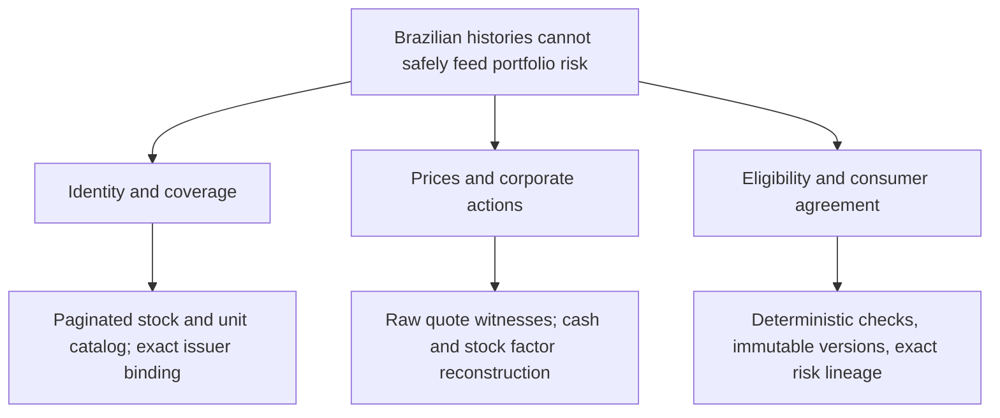

# Brazilian equity coverage: problem tree and release contract

## Problem tree

| Root cause | Implemented control | Evidence required |
| --- | --- | --- |
| A ticker can resolve to another company or share class | Exact requested and returned symbols; profile CNPJ equals saved issuer; coverage says stock/unit; cash and stock events share a valid ISIN | Profile, coverage and source-response hashes |
| Yahoo closes and dividends can already reflect later stock splits | Convert Yahoo prices and cash to the original share scale using corroborated future split factors | Identical split factors and aligned record/ex sessions |
| Gross/net JCP differences resemble bad prices | Compare each vendor return to observed raw prices and reported cash factors; reconstruct a distinct gross-entitlement index | Numerical residual <= 0.00005 |
| Company-specific corrections leak to other stocks | Keep v1 PETR4 engine pinned; v2 engine never reads Petrobras exceptions | Cross-issuer regressions |
| Discovery looks like certification | Catalog discovery has zero verified datasets; each issuer is independently assessed | Completed coverage and normalization checks |
| Producer and consumer differ | Shared assessor bundled in Risk Studio; stateless canary verifies exact hash and calculation version | Consumer receipt before enabling use |

## Scope

The reusable v2 path accepts ordinary/preferred B3 stocks and units with an exact issuer mapping. It is selected for Brazilian histories when both BRAZIL_HISTORY_NORMALIZATION_ENABLED and BRAZIL_MARKET_NORMALIZATION_ENABLED are enabled. It has no ticker allowlist. PETR4 retains its reviewed v1 implementation and immutable historical records.

Support is not a promise that every source can deliver every stock. The catalog includes inactive listings returned by the vendor; an absent delisted security is not claimed as covered. IPOs with less than five years remain short_history. Missing sessions, malformed raw fields, missing event evidence and unexplained factors remain blocked. The configured BrAPI plan must permit the requested history and raw fields; no purchase, credential switching or denial bypass occurs.

Identity cannot be manufactured from the ticker prefix. A saved verified CNPJ is required and must match the profile response. Share-class cash/stock ISINs must agree and pass their check digit. Renames/conversions are rejected on changed identity rather than silently joining histories. Corporate reorganizations require an explicit reviewed lineage before stitching.

## Events and conventions

- Raw BrAPI closes are compared with Yahoo closes on the same share scale; Cota B3 may adjudicate disagreements. The relay is unofficial and upstream independence is not certified.
- Cash amounts must be exact gross raw-rate sums, corroborated by Yahoo after split scaling. JCP withholding candidates describe vendor observations only.
- Verified split, consolidation and bonus factors must match Yahoo on the same ex-session. Simultaneous cash and stock events require review because per-share entitlement scale is ambiguous.
- Subscriptions and unknown events remain review-required. No inferred rights value, cash amount, conversion ratio or event date is allowed.
- Null ex-dates do not become guessed dates. A new issuer cash discrepancy needs issuer evidence; Petrobras amounts are never borrowed.
- The result is a revised gross-entitlement historical index. It is not realized after-tax cash, an official exchange price certificate, or point-in-time backtest data.

## Release and verification

1. CI runs the existing security, type, unit, database, build, consumer and browser checks plus the v2 regressions.
2. Deploy the Risk Studio bundle built by scripts/build-risk-function.mjs before enabling BRAZIL_MARKET_NORMALIZATION_ENABLED. CI emits a chunked, hashed public-source release receipt when RISK_BUNDLE_STDOUT=true; this permits byte-exact deployment through the remote connector when no local build workspace is available. No environment values or credentials are included in the source bundle. Only a fully successful CI run is eligible.
3. Web and worker must run the same merged commit. Enable BRAZIL_MARKET_CANARY_ENABLED once with BRAZIL_MARKET_CANARY_SYMBOLS (maximum eight exact seed tickers). Catalog discovery and selected canaries are stateless and serial; they do not change holdings or repair account data.
4. Record discovered, ready, short_history, unavailable and blocked outcomes separately. A successful sample cannot certify the entire market.
5. Disable the one-time canary after reading results. Keep the ongoing normalization flag; every researched/imported mapped stock then uses its own deterministic assessment.
6. Existing datasets remain immutable. This release does not mass-repair account records or reset retry budgets.

## Authoritative interface references

- https://brapi.dev/docs/acoes/historico
- https://brapi.dev/docs/acoes/dividendos
- https://brapi.dev/docs/acoes/perfil
- https://github.com/brapi-dev/brapi-typescript/blob/main/src/resources/v2/tickers.ts
- https://github.com/brapi-dev/brapi-typescript/blob/main/src/resources/quote.ts

Provider access, market-wide event completeness, delisted coverage and live v2 consumer results must be measured; passing synthetic tests does not establish them.
