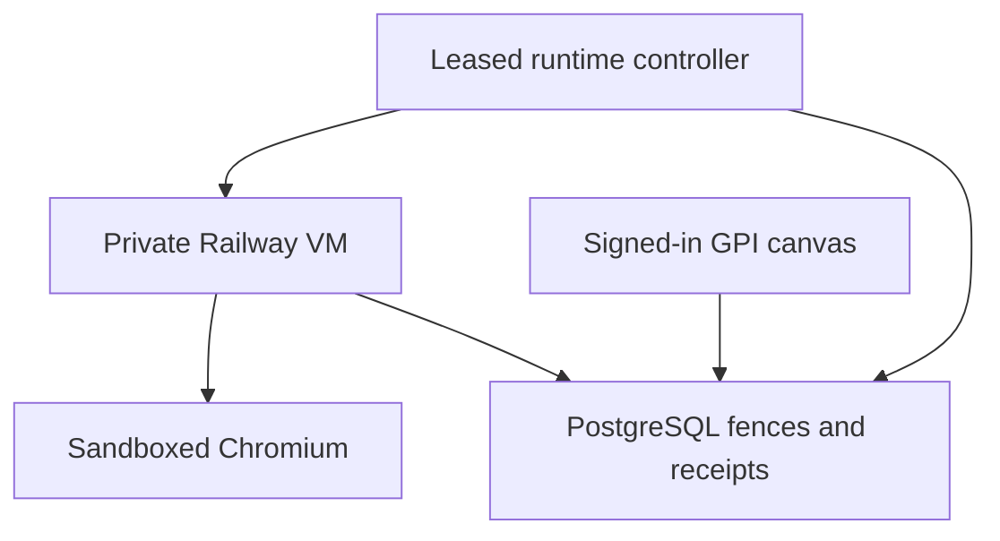

# Supervised browser runtime: diagnosis, implementation and activation

## Problem and plan

| Problem | Evidence | Applied response | Live acceptance still required |
|---|---|---|---|
| Chromium sandbox cannot start in the ordinary Railway container | Staging credentials.cc:131 EACCES; same non-root production engine passed in an isolated VM | Use Railway Sandbox VMs without disabling Chromium sandbox; install browser dependencies from a pinned source recipe | Build and start the new recipe through the deployed controller |
| Earlier VM was a manual experiment with a different Playwright version | VM used 1.64.0; repository used 1.56.1, unsupported on VM Ubuntu 26.04 | Pin Playwright and its test runner to 1.64.1, match Docker image; build from the exact deployed Git SHA and lockfile | Actual VM recipe and restart trial |
| A process unit cannot replace a lost VM | Earlier systemd unit was only a preparation artifact | Persist controller leases, generations, VM/session identity, replacement budget and creation intent in PostgreSQL | Kill the real worker and destroy the real VM during a canary |
| No connection to the user's signed-in browser | Browser connector reported no originating connected browser | Add /browser-verification using the existing GPI session, real canvas and durable server receipts | User performs the displayed steps in their own browser |

## What is implemented

- Migration 007 adds a singleton controller lease and worker generations. One
  controller operates at a time. Production admission ignores unmanaged workers
  and requires a current ready generation and fresh worker heartbeat.
- The existing foundation worker runs the controller only when
  `BROWSER_RUNTIME_ENABLED=true`. Ordinary investment jobs keep their existing
  execution path. No additional AI agents or parallel browser pool are added.
- SDK `railway@3.16.0` builds a credential-free recipe from the exact
  `RAILWAY_GIT_COMMIT_SHA` (or explicit 40-character override). It installs the
  lockfile and Chromium, and runs production isolation preflight as non-root.
- VM runtime receives only database/model references, generation and source
  scope. The Railway control-plane token stays in the controller service.
  No public domain, CDP endpoint, credential file or credential-bearing
  checkpoint is created. The Chromium child still receives a sanitized environment.
- A failed worker/session or lost VM withdraws admission. Confirmed VM destruction
  precedes reconciliation and replacement. Uncertain commands are never replayed.
  Unknown creation outcomes block instead of creating another possible orphan.
- At most three VM creation attempts per hour, one managed VM at a time, 30-second
  replacement backoff, 45-second controller lease, five-second worker heartbeat
  validity and ten-minute provider idle backstop. These bound recovery, not price.
- An expired controller lease fences actions and worker admission independently
  of the controller process. A replacement controller destroys the known old VM
  before admitting a new generation. Database or provider failures fail closed.

## Configure without sending secrets in chat

A dedicated Railway **project token scoped to the chosen environment** is needed.
Create it in the project's Settings > Tokens and store it directly in the
`agentic-worker` service as `BROWSER_RUNTIME_RAILWAY_TOKEN`. The installed SDK
supports the project-token header; actual sandbox permissions remain to be checked.
Do not substitute a human CLI/OAuth credential or broaden token scope silently.

Controller service variables:

| Variable | Value / behavior |
|---|---|
| BROWSER_RUNTIME_RAILWAY_TOKEN | Dedicated environment-scoped project token, entered in Railway only |
| BROWSER_RUNTIME_AUTH_TYPE | project-token (default); do not broaden without reviewing a permission failure |
| BROWSER_RUNTIME_ENABLED | true only for the controlled canary after the token exists |
| RAILWAY_ENVIRONMENT_ID | Railway's built-in environment identity |
| BROWSER_RUNTIME_RELEASE_SHA | Optional exact immutable override; otherwise deployed RAILWAY_GIT_COMMIT_SHA |
| BROWSER_RUNTIME_VARIABLE_SERVICE | agentic-worker (default) |
| BROWSER_RUNTIME_MODEL_KEY_VARIABLE | RESEARCH_MODEL_API_KEY; staging may use OPENAI_API_KEY |
| BROWSER_RUNTIME_MODEL_NAME_VARIABLE | RESEARCH_MODEL_NAME; staging may use OPENAI_MODEL |
| BROWSER_SOURCE_ORIGINS | Reviewed exact HTTPS origins for later public research; empty is sufficient for synthetic verification |
| BROWSER_VERIFICATION_ENABLED | true on web and foundation worker for the isolated signed-in canary |
| BROWSER_WORKSPACE_ENABLED | Keep false/absent until the runtime and signed-in acceptance pass |

The controller and VM must use the same environment as the web application's
DATABASE_URL. No production token or database reference is transferred to staging.
There is no automatic fallback to a broader account token.

## Signed-in acceptance in the user's browser

Open `/browser-verification`. An unauthenticated visit uses GPI's existing login
and returns to this page after sign-in. Verification can be enabled independently
of general browser research. It permits only the fixed synthetic source and
cannot accept synthetic evidence into the financial corpus.

1. Start verification; it pauses after the first real browser observation.
2. Take control and use the observed Annual report link.
3. Inspect replay, return to live, reload and confirm the same run recovers.
4. Resume the deterministic operator; exact evidence is captured and it pauses.
5. Stop and wait for cancellation, then confirm the visible canvas/replay/reload.

The server requires exclusive takeover, resume, exact evidence, stop and a retained
observation before accepting the visual confirmation. The latter is explicitly
labelled a **user report**, not automated visual proof. A bounded structured log
`browser_signed_in_verification` records completion without screenshots, tokens,
page text or account credentials. This avoids dependence on a connected extension.
The earlier live-model canary is separate; this verification makes no model calls.

## Verification and release gates

Unit tests cover failed/unknown creation, stale controller authority, lost worker,
confirmed destruction before replacement and budget exhaustion. The native
PostgreSQL CI check covers controller exclusion, expiry and uncertain creation
fencing in addition to existing concurrent admission/claim/crash checks. The real
Chromium/React test now exercises the signed-in canary while general research is
still disabled, including reload, resume, exact capture, stop and confirmation.

Live provider provisioning, real worker/VM kill trials and the actual user's
signed-in confirmation must be reported separately from fixture or mocked tests.
A smooth status display is not proof of financial accuracy or production reliability.

## Recovery and rollback

Disable `BROWSER_WORKSPACE_ENABLED` and `BROWSER_VERIFICATION_ENABLED` on web to
stop new access. Disable `BROWSER_RUNTIME_ENABLED` on the foundation worker to
stop supervision. On normal shutdown the controller withdraws readiness and
attempts confirmed teardown. If termination interrupts it, the controller lease
expires and workers stop; the VM idle backstop remains ten minutes. Verify
teardown in Railway rather than infer it solely from elapsed time.

If creation returned an unknown outcome, inspect Railway Sandboxes and destroy
only the runtime's orphan VM before clearing the blocked controller state. Never
reset the blocked state blindly or delete unrelated sandboxes. Retain additive
schema and action receipts for audit. The old systemd unit is superseded by the
managed controller and is not a production deployment instruction.

References: https://docs.railway.com/sandboxes and
https://docs.railway.com/guides/lock-down-production-project . Implementation uses
the installed SDK types and README; provider behavior still requires a live trial.
