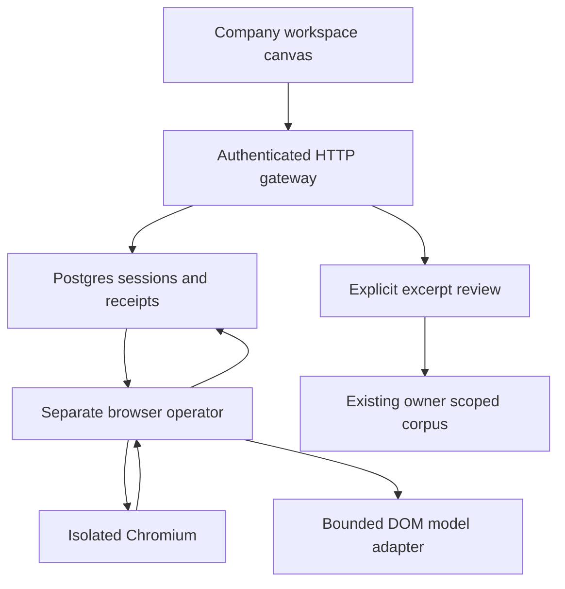

# Browser research workspace — implementation and release record

Baseline: `1414089975f43b9da46f733898ac7e1a875f3edb`, branch `feat/browser-research-workspace`.
The existing signed-in production workflow remains unverified. No authentication bypass or new login provider is introduced.

## Outcome and supported scope

An issuer-specific public HTML research workspace is integrated into the existing company Sources panel. It has actual Chromium frames, a React canvas, keyboard link navigation, stable identities for up to three tabs, exact model DOM observations, action receipts, human takeover, stop, reconnect and reviewed corpus ingestion.

The adapter is deliberately a public reader: site JavaScript, forms, editable pages, private sign-in, downloads, WebSockets, service workers and unsolicited popups are disabled. PDFs remain on the established FilingLens ingestion path. Vision-only/canvas sites are unsupported; the model adapter uses DOM observations. This is not a general desktop browser or a replacement for the existing GPI login.

## Architecture decision



| Candidate | Fit and trade-off | Resource/latency basis | Decision |
|---|---|---|---|
| Existing corpus, no browser | Reliable structured acquisition; no live interaction | Existing workers and retrieval | Preserved as first choice for files and financial data |
| Custom browser frames and canvas | Exact observation references and server-controlled input; more application code | One Chromium process per active worker; 750 ms HTTP stream cadence, capture cost measured separately | Selected. Pull-based SSE avoids assuming Next supports WebSocket upgrades; no CSP relaxation |
| Managed embedded viewer | Potentially faster implementation; vendor view-only/privacy controls require proof | Provider/browser-minute and egress charges unknown | Deferred; no provider account assumed |
| Headed browser/noVNC | Useful for OS dialogs; unnecessary desktop and input surface for public HTML | Additional display server and remote desktop cost | Rejected for this scope |

One operator owns a mutable session. No swarm or parallel agents are added. Worker concurrency is one, independent of existing foundation jobs. The model adapter reuses the existing fixed OpenAI endpoint and configured research model; no new provider or model name is invented.

## Execution and data contracts

- Additive migration `005_browser_workspace.sql`: sessions, commands, ordered events and retained observations. Applied twice in the isolated database test.
- Account ownership is derived from the existing session. Every snapshot, stream pull, observation and command rechecks authentication. Only the creating human's original login session may control a run. Viewers cannot mutate.
- Commands are persisted before acknowledgement. Dispatch receipts commit before execution. Row locks and control epochs fence execution; takeover acknowledgement waits for the current dispatch. Late model answers cannot execute after takeover.
- A reconnect only requests a snapshot/event cursor. It never resubmits a command. Unknown worker outcomes become `reconciling` and are not reclaimed.
- Fresh observations follow navigation, tab selection and human control changes. Canvas points are converted to observed anchor navigation, never arbitrary form or script execution.
- Live frames and retained model observations have different IDs. The current frame is overwritten, not appended to a video log. SSE uses pull backpressure and a zero-length producer queue, and renews after 20 seconds.
- Limits: one active session per account, ten starts per day, three tabs, 30 actions, fewer than 20 model calls, 60,000 accounted tokens with conservative pre-call reservation, five-minute research wall-clock budget and ten-minute absolute session lifetime. Up to 60 ordinary human/control commands; stop remains available. Responses, network requests and total source bytes are bounded.
- Exact quote matching establishes capture integrity only. Captures preserve issuer/year scope, original/final URLs, observation/action IDs, timestamps, text offsets and SHA-256. Source identity and period remain user assertions until review.
- Explicit review adds a `user_upload` excerpt through `saveDocument` with preserved `browserProvenance`; it does not label financial values verified. Synthetic fixtures cannot enter the corpus through the API.
- Browser snapshots/events expire after seven days. Accepted corpus excerpts follow existing corpus deletion policy. Backups are outside this deletion guarantee.

## Security controls and limits

| Boundary | Implemented control | Remaining verification |
|---|---|---|
| Owner/account | Existing revocable login and role checks on every access; worker membership checks before actions | Signed-in staging/production user journey |
| Network | Exact HTTPS origins, no credentials/IP literals; validated IPv4 DNS pinned to TLS; redirects revalidated; byte/deadline limits | External network canary and container isolation validation |
| Chromium | New context/profile per task, sanitized child environment, dead proxy and disabled DNS fallback, JS off, no exposed CDP | Container startup requires Chromium sandbox in production; never fall back to disabling it |
| Private content | No private login; editable/iframe pages blocked before observation or frame capture | Adapter intentionally cannot offer private sign-in |
| Model injection | Typed allowlist, independent network/ownership/budget controls, no generated code execution | Broad multi-model adversarial evaluation not claimed |
| Recovery | Epoch fences, once-only commands, no uncertain replay, independent expiry in foundation worker | Native multi-process PostgreSQL crash/race and infrastructure kill tests |
| UI | Semantic controls, status text, keyboard links, live/replay separation, real frame tests | Formal WCAG audit and human usability study not performed |

No new financial extraction, valuation publication, holdings or trade execution permissions are introduced. Source screenshots and model statements never qualify financial accuracy.

## Reproduce validation

```sh
npm ci
npx playwright install chromium
npm run browser:verify
npm run browser:test
npm test
npm run lint
npm run typecheck
npm run build:worker
npm run build
npm run test:e2e
npm run test:e2e:production
FILINGLENS_TEST_ROOT=/path/to/FilingLens npm test -- tests/approval-flow.integration.test.ts
```

Observed locally on 2026-10-18:

- Real Chromium report lookup and exact quote capture: 3/3 trials passed. Earlier single-tab trial times were 233–308 ms; these are fixture timings, not production latency or capture-to-display percentiles. JPEG report frames were 29,552 bytes.
- 30 focused tests passed, including actual password/session API and isolated PostgreSQL engine, cross-owner denial, replay access, viewer denial, command idempotency, lease expiry, late-model takeover race, human input once-only, logout, and real React canvas over authenticated SSE.
- Existing suite at the intermediate check: 216 passed, two skipped. The cross-application approval test was then run explicitly and passed with the current FilingLens checkout.
- Existing development browser journeys: 3 passed at desktop/mobile widths. Type checking, lint (one pre-existing warning), application build, worker build and production dependency audit passed. Final release checks are recorded in CI.
- Synthetic private-input page is refused before pixels/text are returned; unsupported tool actions and network targets are rejected.

No live provider result, production usability, broad forecast accuracy, cost per success, p95 frame latency or production reliability is inferred from these fixtures. The test SQL adapter is PGlite, not a substitute for a native concurrent-Postgres load test.

## Deployment configuration and gates

Web and existing foundation worker:

- `BROWSER_WORKSPACE_ENABLED=true` only after the browser worker and signed-in canary pass; absent/false keeps the feature hidden and APIs disabled.
- `BROWSER_SOURCE_ORIGINS` is a comma-separated list of reviewed exact HTTPS origins. No wildcard or client-supplied expansion.
- Run the additive migration before enabling.

New isolated worker uses `Dockerfile.browser` and `railway.browser-worker.json`, with no public domain/CDP port. Required references: `DATABASE_URL`, `RESEARCH_MODEL_API_KEY`, `RESEARCH_MODEL_NAME`. Keep all secrets server-side; the Chromium child receives none of these environment variables. One replica initially. Do not grant it unrelated integration credentials.

`scripts/browser-service.ts` first runs the controlled Chromium acceptance fixture using the production sandbox. `BROWSER_CANARY_ONLY=true` serves a minimal readiness response after that test and does not access the database or call a model. Use this in staging first. A sandbox failure blocks worker enablement; it must not be repaired by weakening isolation.

Production feature enablement is blocked until container isolation, live model operation, native database concurrency and signed-in acceptance pass. Merging/deploying disabled code is separate from enabling a verified browser service.

## Rollback

Set `BROWSER_WORKSPACE_ENABLED=false` on web to stop creation/access. Drain or stop the separate browser worker; termination closes Chromium and records cancellation where reachable. The independent foundation reaper marks expired work for reconciliation. Keep additive tables for audit/retention; do not drop them. Revert application code to the prior release if needed; existing financial/portfolio records are unchanged.

Confidence: 4/5 in the locally tested public-reader slice; production readiness remains unverified until the gates above pass.

Primary API references checked: https://playwright.dev/docs/network and https://playwright.dev/docs/api/class-route. Service workers are explicitly blocked because route interception does not cover their independent requests. Installed Next.js route-handler and client-component guidance was read before implementation.
