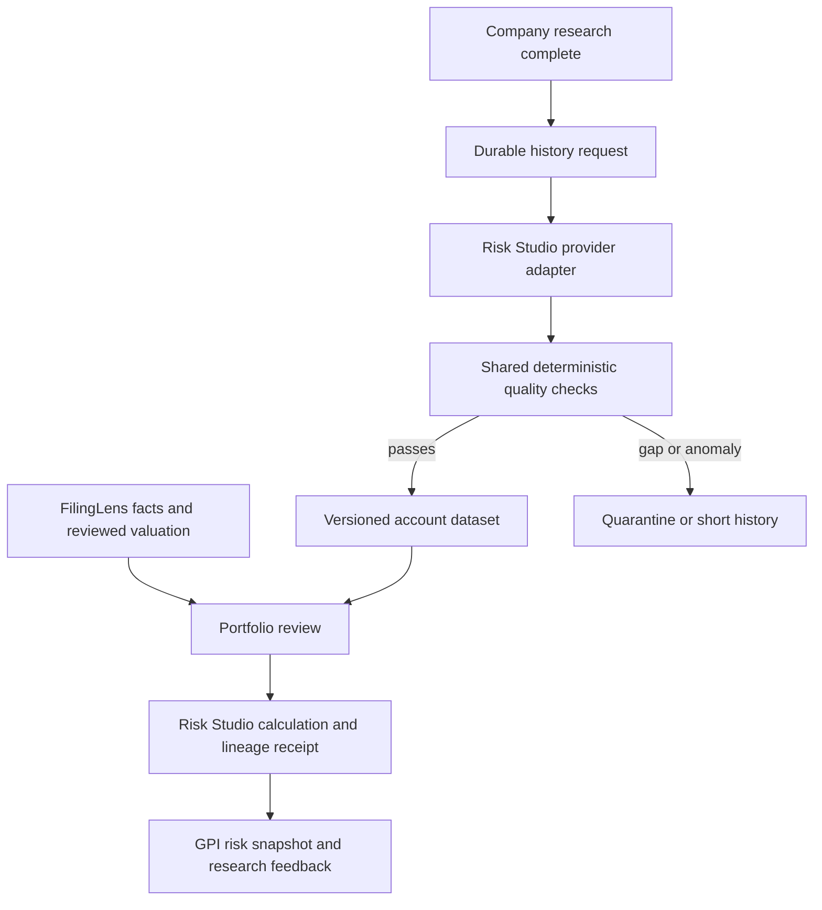

# Research recovery and five-year market data

## 1. Dependency mapping and risk analysis

Observed screenshot: an AAPL saved research card exposed `disabled_or_no_evidence` and said FilingLens reads were disabled. This describes a saved run, not necessarily current connectivity. Production has separate web and worker configuration; both need finance reads enabled. Earlier saved evidence must remain immutable.

Hard constraints: retain auth and account scope, original issuer identity and source lineage; keep financial valuation in FilingLens and portfolio calculations in Risk Studio. No automatic holdings or trades. New data preparation reads public historical data and invokes no model.

Five years is a requested calendar window, not a fixed 1,260-row guarantee. Listing inception, suspensions, holidays, missing quotes and corporate actions affect coverage. Historical data is not evidence of forecast accuracy.

## 2. Architecture proposals

| Candidate | Feasibility and workflow | Cost per execution | Latency | Controls and verification | Trade-off |
|---|---|---|---|---|---|
| Baseline: on-demand provider reads | Existing Risk Studio volatile cache | Zero model calls; reads per holding and benchmark | Provider critical path plus FX/classification; unmeasured | Existing response contracts; no durable market dataset | Fast to use; weak reproducibility and silent adjustment fallback |
| Selected: durable deterministic pipeline | GPI queues after committed research; Risk Studio reads provider; shared checks; immutable snapshots; explicit risk calculation | Zero additional model calls; typically two price reads per issuer, two hosts only on failure; one snapshot write; one risk HTTP request | Queue poll 5 seconds plus bounded 45-second provider operation, then normal risk stages; limits, not measured p95 | Database uniqueness, renewable-job fencing, hashes, identity/basis/calendar/price checks, account tests and adverse fixtures | More storage; reproducible and inspectable, no new service or agent |
| Agent supervisor with provider critics | Technically possible, unnecessary for deterministic quality rules | Additional model calls/tokens and coordination; prices unknown | Extra sequential review and retries, unmeasured | Would still require all deterministic controls and comparison trials | No demonstrated benefit; not selected |

All resource/latency estimates above are modeled. Production provider latency and error rates require measurement. A licensed independent feed would improve reconciliation, but is a separate provider entitlement, not an extra agent.

## 3. Comparative pros and cons

The selected pipeline improves versioning, correction visibility, deterministic checking and operating clarity over the baseline. It does not establish vendor price truth or future investment performance. A swarm has higher latency/cost and cannot replace source contracts. Existing one-operator browser sessions remain suitable for source discovery; API history ingestion belongs outside the browser and model loop.

## 4. Recommended architecture

Retain the bounded research manager and existing live Chromium workspace. Use the durable deterministic pipeline for market history. Compare independent data feeds only after credentials, permitted use and adjustment semantics are established. Add another worker service only if measured queue wait or execution pressure justifies it; this change runs one bounded history read independently of narrative research in the existing worker.

## 5. Implementation blueprint

- `008_market_history.sql`: additive owner-scoped request and immutable-version tables. Successful research completion and history enqueue commit in the same transaction. Unique owner/listing/issuer/request-date keys reuse duplicate daily requests.
- History requests have queued/running/complete/failed states, 90-second leases, token-fenced writes and at most three attempts. Recovery retries only read operations. Quarantined datasets are successful acquisitions, not approved risk inputs.
- Provider response retains unadjusted close, vendor adjusted close, volume, dividend/split events, requested dates, exchange, currency, timezone, retrieval timestamp, original endpoint and reference-session dates. It is the archived adapter response, not a byte-for-byte archive of the vendor HTTP envelope.
- A canonical SHA-256 hash covers the full adapter payload. The immutable ID includes that hash. Canonical ordering survives JSONB key reordering. Checks rerun before five-year consumption and dataset inspection; read routes scope by signed-in user.
- Reject malformed/duplicate/out-of-order/future/nonpositive prices, null adjusted values, wrong symbol/issuer/exchange/currency/timezone, unsupported source origin and stale retrieval. Missing reference sessions and extreme adjusted daily changes above 50% quarantine a dataset. This conservative threshold is a review trigger, not proof of error.
- Reference ETF sessions (SPY or BOVA11.SA) are an explicit calendar proxy. No forward filling or zero returns for gaps. A return after a missing session is null. Short histories remain visible and cannot impersonate five years.
- Derived records retain simple/log daily returns and deterministic sample volatility (252-session convention), drawdown and daily historical VaR/CVaR. These are diagnostics in listing currency; Risk Studio separately converts dated prices/FX for portfolio calculations.
- Only five-year portfolio requests require prepared datasets. They read from GPI storage, verify identity/hash/freshness/quality, pass exact versions to Risk Studio, and verify the returned lineage receipt before retaining results. Existing shorter ranges retain their disclosed legacy provider behavior.
- Dataset listings exclude daily return arrays to avoid polling oversized payloads; authenticated inspection retrieves the full dataset separately.

### Interaction specification

| Surface | Visible state and action | Backend and acceptance |
|---|---|---|
| Saved research card | Plain-language saved outcome, saved date, current finance flag, Retry evidence pack and company workspace actions | New read creates a new run; previous evidence is preserved; keyboard retry works |
| History panel | Pending/running/failed request and quality-passed/short/quarantined/stale dataset, observation dates/count, inspectable JSON lineage | Same-origin editor mutation; authenticated owner read; failures retain prior versions |
| Portfolio form | Five-year option and explanation of prepared dataset requirement | No holdings transfer until existing explicit sharing confirmation; bad history stops calculation |
| Browser workspace | Existing live/replay distinction, takeover and stop remain in force | Runtime/controller logs checked separately; no browser OCR becomes a financial fact |

## 6. Verification and release plan

Run quality/math adversarial fixtures, migration replay and real SQL persistence, retry/fencing/owner-isolation tests, provider missing-adjustment tests, UI recovery and 390/1440px layout checks, typecheck/lint/build/worker build, existing regressions and CI. A fresh real AAPL read is a canary, not broad reliability evidence. Validate a real signed-in preparation and risk request when the browser session is available. Record live failures explicitly.

Rollout: build the complete Risk Studio function with `node scripts/build-risk-function.mjs`; compare its prior deployed source with versioned source, deploy the tested bundle, enable finance reads on GPI web/worker, wire worker Risk Studio variables through existing same-project references, and enable `MARKET_HISTORY_ENABLED`. Observe terminal Railway SUCCESS and read-only startup canary results. Rollback disables the market-history flag and keeps the additive audit data.

### Residual limits

The default feed is unofficial Yahoo Finance, already used by Risk Studio; it has no verified SLA or independent reconciliation. Provider-adjusted close is not independently certified total return. ETF calendars cannot detect a feed-wide missing session. Suspensions and legitimate extreme returns can quarantine good data. Full exchange calendars, licensed secondary prices, delisting returns, universe survivorship controls and transactional performance require further data capabilities. This first release is a per-selected-company current-holdings history pipeline, not a survivorship-free backtesting database.

Primary sources informing the design: [brapi historical prices](https://brapi.dev/docs/acoes/historico) recommends adjusted close for returns; [Alpha Vantage adjusted daily data](https://www.alphavantage.co/documentation/#dailyadj) distinguishes raw prices, adjusted closes and split/dividend events; [Microsoft human-AI interaction research](https://www.microsoft.com/en-us/research/publication/guidelines-for-human-ai-interaction/) supports explicit limitations and recovery. They do not certify this implementation or the Yahoo feed.

Confidence in the architecture: 4/5. Most consequential gaps: independent price ground truth and broad live cross-market evaluation. Release measurements belong in the PR and deployment receipt.
