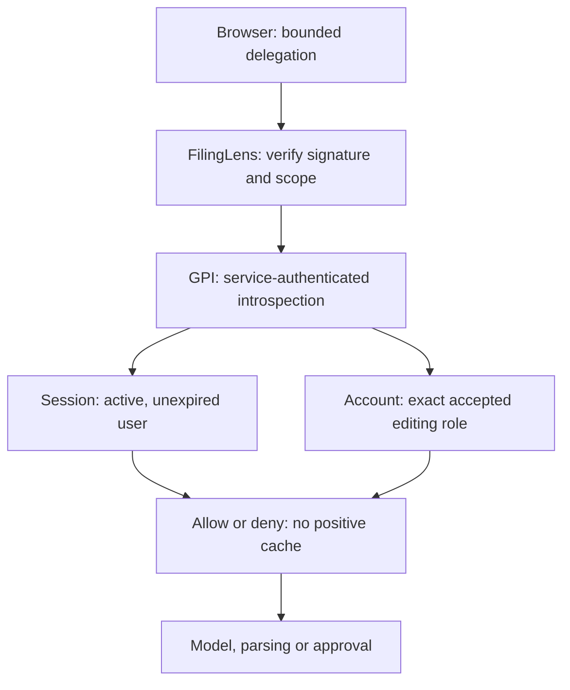

# Secure GPI review — 16 October 2026

Baseline: GPI `01282c10e23451baba87f30dee8f109543ac3c29`, FilingLens `2848e5f9d9ec1837353b891a783582aabe42f818`; three independently discovered Railway projects, 18 services. Personal research, no trading. This is a scoped engineering review, not a penetration-test certificate or ASVS conformance claim. Confidence 4/5 for reproduced code findings; authenticated production acceptance remains unverified.

## Assets and trust boundaries

Browser session → GPI account and owned PostgreSQL records → signed issuer/workspace handoff → FilingLens analysis/approved MySQL versions → service-authenticated Risk analytics → GPI saved decision. Public regulator evidence is not private research; original bytes and derived facts have separate provenance. Worker/model/provider, private Python parsers, GitHub build artifacts, Railway variables and encrypted backup objects are separate boundaries. Session cookies, signing keys and service tokens must never become model context or public browser configuration.

GPI owns account/session authorization; FilingLens owns financial computation and approved versions; Risk owns deterministic analytics. Existing independent deployment and stores remain. Public examples may be readable; paid inference, uploads and generated server artifacts require explicit authenticated delegation. An anonymous browser-local history identity is not a GPI account identity. Retention of old approved versions, complete backup scope, object deletion, deployment collaborator access and credential rotation are not independently verified here.

## Prioritized register, before implementation

Scores are likelihood × impact, ordinal judgments. Exposure and exploitability are distinguished. Owners are recommended roles, not accepted assignments; immediate findings are due before this release, residual items before wider access unless stated otherwise.

| ID / priority | Evidence, asset and abuse prerequisites | CIA impact; L × I / confidence | Remediation / owner / negative test / residual |
|---|---|---|---|
| SEC01 P1 confirmed | FilingLens `api/boot.ts` MODEL_ROUTES at baseline: anonymous POST reaches configured paid model; no credentials required | Availability/cost; 4×4=16, 5/5 | Require signed GPI delegation plus online session/account check before parsing/execution. App owner; anonymous/forged/expired/revoked/viewer requests never reach handler. Stolen active delegation and aggregate authorized spend remain risks. |
| SEC02 P1 confirmed design gap | Both handoff contracts contain no session binding; valid two-hour ticket remains usable after logout | Integrity/authority; 3×4=12, 4/5 | Bind new handoffs to originating session, check revocation, user disable and exact accepted account role; apply to costly operations and approval. Identity owner; test logout and membership downgrade. An already-started request cannot be recalled atomically. |
| SEC03 P2 confirmed | Public `/api/extract` and `/api/presentation` parse uploads/generate artifacts without delegated authority | Availability; 3×3=9, 4/5 | Apply same access boundary before body parsing/private tools; retain existing format/size/parser bounds. App owner; missing authorization must not invoke parser/provider. Authorized parser isolation/CPU exhaustion needs wider review. |
| SEC04 P2 confirmed hardening | Both repos use mutable `actions/*@vN` references in workflows | Build integrity; 2×4=8, 5/5; compromise not observed | Resolve official tag SHAs, pin actions, disable unnecessary checkout credential persistence, add update ownership. Delivery owner; workflow policy fixture rejects tags. Official action compromise is still possible. |
| SEC05 P2 confirmed | GPI `scripts/check-dev-audit.mjs` treats JSON error/no vulnerability map as clean | Detection/availability; 3×3=9, 5/5 | Reject missing/error/malformed scanner evidence; test failure, malformed, unapproved severe findings and documented exception. Delivery owner; failing registry is never clean. Scanner database freshness is external. |
| SEC06 P2 confirmed hardening | FilingLens CI has no production dependency advisory gate | Supply-chain integrity; 3×3=9, 4/5 | Add blocking production audit; retain explicit unrelated lint baseline. Delivery owner; scanner nonzero blocks CI. Secret/SAST/image scanning remain separate gaps. |
| SEC07 P2 partially confirmed | Official-source acquisition has strict hosts/no redirects; DNS resolution is not connection-pinned | SSRF/network; 1×4=4, 3/5; attacker needs approved DNS/network compromise | Retain allowlist and no-redirect checks; verify IPv4/IPv6/rebinding defense before expanding hosts. Ingestion owner; controlled DNS fixtures only. No real metadata or denied SEC probe. |
| SEC08 P2 confirmed design gap | `api/private-history.ts` MAC covers opaque token but no server expiry; browser Max-Age alone does not revoke copied cookie | Confidentiality; 2×3=6, 4/5; stolen cookie required | Plan versioned expiring server session with migration/recovery for existing browser histories. Identity/data owner, before broader private upload use; replay-after-expiry test. Do not delete or strand history in this patch. |
| SEC09 P2 unverified | No complete current secret/SAST/image scan or collaborator/branch-protection export | Confidentiality/build integrity; likelihood unknown, impact4, confidence2/5 | Inventory platform controls, run scoped scanners with version/database/artifact records. Security/delivery owner before wider deployment. No clean-scan claim from absence of alerts. |
| SEC10 P2 partial | Phase1 isolated restore markers exist; full authoritative approved-version/source/decision recovery not established | Integrity/availability; 2×4=8, 3/5 | Isolated full-scope restoration and agreed RPO/RTO. Data owner before wider private-data use. Code rollback cannot restore lost data. |
| SEC11 P2 partial | RAG tools have closed schema and no generic fetch/shell/SQL; broad malicious-document/model evaluation incomplete | Integrity; 2×4=8, 3/5 | Preserve external tool authorization and test malicious tool arguments; wider entailment/redaction evaluation. Research owner. Prompt wording is not an authorization boundary. |
| SEC12 P2 confirmed | Model execution limits are per process/request, not durable account-wide spending quota | Availability/cost; 2×3=6, 5/5; authorized/stolen capability required after SEC01 | Keep local bounds; design durable account allowance with measured budget and atomic reservations. App/data owner before multi-user expansion. No claim of global spend ceiling. |

## Invariants and release plan

1. Denied delegation never reaches model, parser, external regulatory lookup or presentation generation. Signed delegation binds workspace, reviewer, issuer, expiry and originating session; caller-supplied workspace is not authority.
2. GPI introspection is service-authenticated, bounded, no-store and discloses only an allow/deny result. A disabled user, expired/idle/revoked session or non-editing/unaccepted membership fails closed. No positive authorization cache.
3. Existing publication arithmetic, immutable versions and issuer reconciliation remain unchanged. New publication also requires current delegation. Existing tickets without session binding need a fresh GPI launch.
4. Release FilingLens consumer first, then GPI session-bound producer, with exact cross-app CI pin. During transition old tickets cannot start protected work; show recovery to GPI. No database migration or secret rotation.
5. Retain prior artifacts for rollback, but do not restore anonymous paid execution as an incident workaround. Contain by disabling paid provider access if secure forward recovery is unavailable. No production fault injection or destructive restore.

## Control matrix and evidence

Applicable ASVS 5.0.0 Level 2 is the initial verification target, not a conformance assertion. The actual tagged V7, V8 and V9 requirement text was read from OWASP before assigning these references: [session management](https://github.com/OWASP/ASVS/blob/v5.0.0/5.0/en/0x16-V7-Session-Management.md), [authorization](https://github.com/OWASP/ASVS/blob/v5.0.0/5.0/en/0x17-V8-Authorization.md), [tokens](https://github.com/OWASP/ASVS/blob/v5.0.0/5.0/en/0x18-V9-Self-contained-Tokens.md). Selected L3 operation-revocation guidance is also useful; testing a subset does not establish L2 or L3 compliance. OAuth authorization-server, WebRTC and autonomous-trading controls are outside the observed product scope.

| Control / applicable scope | Implemented and tested evidence | Remaining gap / owner and review trigger |
|---|---|---|
| IAM / GPI sessions; v5.0.0-7.2.1, 7.3.1–2, 7.4.1–2 | Existing backend sessions/MFA/origin checks retained; new introspection checks revocation, idle/absolute expiry and disabled users | Authenticated production browser unavailable; identity owner before wider use |
| AUTHZ / accounts and services; v5.0.0-8.2.1–2, 8.3.1, 8.4.1 | Actual DB tests cover accepted role, exact workspace, viewer/unaccepted/removed membership and service identity; private handoff redemption rechecks current authority | Broader role/admin review and deployment collaborator access not independently established |
| TOKEN / v5.0.0-9.1.1–3, 9.2.1–4 | Existing HMAC/expiry retained, explicit audience/permissions/session binding added; legacy, forged, expired and wrong-scope cases deny | Active bearer theft and same-origin script execution remain risks; preserve key separation/rotation review |
| SECRET / server and browser | No secret values retrieved; only Railway variable names inventoried. Client helper sends delegation only to exact local protected routes | Full secret scan, image-layer audit and rotation rehearsal not executed; security owner before broader private-data use |
| EDGE / HTTP and UI | Denial occurs before parser/model; bounded introspection request/response and timeout; no redirects. Browser does not promote local storage into authority | Wider XSS/CSP, archive/parser isolation and upload-CPU testing remain open |
| INGEST / official sources | Strict source host/path allowlist, size limits and redirects disabled in inspected documents code | DNS connection pinning not established; no metadata probes or denied SEC requests performed |
| DATA / financial evidence | Existing exact-source, identity, period/currency, immutable version and numerical regression suites retained | No financial formula or approved value changed; independent source truth/restatement propagation coverage incomplete |
| STORE / owner data | DB-backed account tests and existing corpus/valuation read isolation tests; no shared database introduced | Store TLS certificate configuration, retention/deletion and complete recovery not independently established |
| AGENT / untrusted filings | Forbidden fetch/shell/SQL/holdings mutation and scope-changing tool arguments rejected outside the model; existing execution/cancellation bounds retained | Not broad all-model prompt-injection resistance; durable aggregate spending quota remains open |
| SUPPLY / CI | Verified official action tag commits pinned in all six workflows, read-only PR CI, checkout credential persistence removed where not needed; npm production gate added to FilingLens; GPI scanner errors fail closed | Full SAST/secret/image scans absent. Existing GPI dev-only advisory exception retained and disclosed; maintainer review required |
| RUNTIME / actual Railway topology | GPI, FilingLens and Risk inventory/config/health inspected; Risk live source exactly matches tracked code; private Risk API denies anonymous POST. Preview services have no public domains in inspected config | Preview skill runtime still holds a model-key variable; review need/privilege. Source checkSuites is false on inspected main apps: PR CI gates are used, direct-main deployment enforcement remains open |
| DETECT / security events | Existing GPI authentication event system retained; denial is no-store and logs do not include new tickets or source bodies | New central alert/retention path not installed or exercised; operations owner must choose cadence/thresholds |
| RECOVER / continuity | No persistence/schema change; Phase1 restore evidence from earlier audit remains a limited existing control | No full restore or secret-rotation exercise this audit; data owner to agree RPO/RTO and schedule isolated proof |

## Verification record

Synthetic setup only for auth/DB/model tests. PGlite replaces DB transport in tests; application password/session, signed handoff, FilingLens middleware/publisher and GPI introspection execute their actual implementations. A synthetic successful provider handler is used to test admission without spending model tokens. Real production account/session positive-path verification is separate and remains unverified. No production account, portfolio, holding, valuation or secret was created or extracted for this review.

| Case | Expected / observed evidence | Environment and cleanup |
|---|---|---|
| Anonymous protected operations | Seven protected route tests return 401 before any fetch/parser/provider; four path variations return 401/404 | Real Hono boot app in isolated tests; globals restored |
| Forged/expired/legacy/wrong audience or permission | Reject before introspection or downstream work | Signed synthetic fixtures; no production keys |
| Logout, expiry, disabled identity and downgraded role | Valid permission first passes, then DB mutation makes the same ticket fail immediately | Real GPI query logic against disposable PGlite; closed after tests |
| Account fallback and second principal | Different workspace/reviewer/session cannot reuse another principal's entitlement; valuation ID wrong-owner read remains denied | Isolated implementation tests; no private production records |
| Upstream failure/configuration/redirect/large malformed response | Return unavailable; never allow or retry paid work | Mocked authorization transport only |
| Private corpus handoff after revocation | Authorization denied before reading any private document | Mock storage spy plus independently tested real authorization query |
| Signed-in approval flow | Real isolated sign-in → bound ticket → admitted handler → deterministic valuation → commit → signed event → GPI import → portfolio → logout; further inference/publication denied | Synthetic financial evidence/provider; isolated stores; no network providers |
| Scanner outage | Baseline script exits 0 on a synthetic npm error JSON; patched script exits 1 | Disposable fake npm executable; temp directory removed |
| CI boundaries | Structural policy tests reject mutable remote actions, privileged PR tokens and deployment secrets in PR CI | Not an executed malicious-PR penetration test |
| Malicious filing/tool arguments | Requests for fetch/shell/SQL/holding edits or issuer override rejected by strict server tool schema | Does not establish broad model refusal/entailment quality |

Node v24.19.0, npm 11.9.0, Python 3.12.14; GPI Vitest 4.1.11, FilingLens Vitest 4.1.11 in this environment. npm audit report format 2 queried on 16 October 2026. Production dependency reports: zero known vulnerabilities in both repositories, exit 0. Full GPI audit exits 1 with five high dev-only dependency records from GHSA-vfj7-8cjw-p6xm; its existing narrow checker exception passes with an explicit warning. [GitHub's advisory](https://github.com/advisories/GHSA-vfj7-8cjw-p6xm) was refreshed: last updated 2 October 2026, no patched braces release listed. The npm suggestion to downgrade Next's ESLint chain is a major incompatible change, not applied. No new exception is approved by this report; the inherited exception's accountable acceptance/expiry must be reviewed by the maintainer. gitleaks, Semgrep and Trivy are unavailable locally; those scans are NOT RUN, not clean.

Baseline live anonymous probes at 14:05:36–38 UTC: GPI workspace/corpus/portfolio and Risk private analysis return 401; FilingLens metadata/agent with empty invalid bodies return 400, corroborating access to handlers before authentication without requesting inference. No valid document was sent and no SEC/market fetch was triggered.

## UX and operational acceptance

Surface: existing document/valuation workspace, with a visible GPI entry/recovery link. No new login provider, credential-entry field or approval popup. Authorization errors stop the affected request and do not retry a paid call. Completed analysis/assumptions stay in the current tab; users are told to keep that tab open or export before opening a new handoff. A fresh issuer context still resets the financial session as before; data is not promised to survive a tab reload. Status and public examples remain readable. Keyboard-accessible native link and text status are retained; a full WCAG/user study is not claimed.

Release results and remaining production acceptance evidence are appended after required CI and terminal deployment states. No release recommendation is made for a build with an exploitable private-data authentication bypass, exposed secret, arbitrary execution path or financial regression.

Local verification before release: GPI full suite **180 passed / one conditional cross-app skip**; that cross-app test passed separately against FilingLens PR93's exact source. FilingLens full suite **361 passed**, followed by its additional audience/purpose regression passing (the complete CI result is authoritative for the final total). Both typechecks, GPI worker/web builds and FilingLens production build pass. GPI lint has zero errors/one existing warning. New/changed security paths lint clean; the modified legacy comps HTTP test retains five pre-existing explicit-any errors and the wider FilingLens lint baseline remains nonblocking, disclosed rather than suppressed. No new dependency or formula change.

Production-artifact GPI browser suite **3/3 passed** after installing its missing pinned Chromium binary. The first local attempt failed because that binary was absent; the official installer recovered from a truncated download using its built-in mirror. A new versioned `scripts/verify-filinglens-security.mjs` uses only a disposable local built FilingLens server and synthetic credentials/documents: **390px and 1440px cases passed**, covering anonymous/forged delegation denial, visible GPI recovery link, native keyboard focus, retained selected filename and no horizontal overflow. The synthetic server-key canary does not appear in returned HTML. This is not a scan of actual secret values or a complete WCAG/browser-security certification. The new smoke is wired into GPI CI against the exact FilingLens implementation.

Official remote action refs resolved before pinning on this date: checkout v4 → `11d5960a326750d5838078e36cf38b85af677262`; setup-node v4 → `49933ea5288caeca8642d1e84afbd3f7d6820020`; setup-python v5 → `a26af69be951a213d495a4c3e4e4022e16d87065`; upload-artifact v4 → `ea165f8d65b6e75b540449e92b4886f43607fa02`. Existing npm update automation is preserved; action-update review is added monthly as a project maintenance choice, not a security standard. [GitHub secure-use guidance](https://docs.github.com/en/actions/reference/security/secure-use) supports immutable action refs and minimal permissions.

Risk Studio source was fetched from both deployed functions and compared byte-for-byte with GPI's tracked `ops` source: both match. No Risk calculation or deployment is changed here. Anonymous access to its integrated analysis route is denied. Older FilingLens previews have private endpoints but no public service domains in inspected configuration; private-only is not equivalent to authenticated or harmless. The skill preview retains a model-key variable name and requires lifecycle/credential privilege review. No secret value was read.

The connected browser could not establish a session (RPC connection closed). No further sign-in request or credential extraction was attempted. Authenticated production admission, logout propagation across actual deployed services, private-store network/TLS policy, production credential equality and user usability remain material evidence gaps. The explicit existing service variable names are present on both sides, but presence does not prove that their values match. Shared HMAC verification also retains a trust assumption between GPI and FilingLens: a compromised signing service is not contained by this patch; asymmetric delegation or independent issuer keys would require a separately verified key migration.
